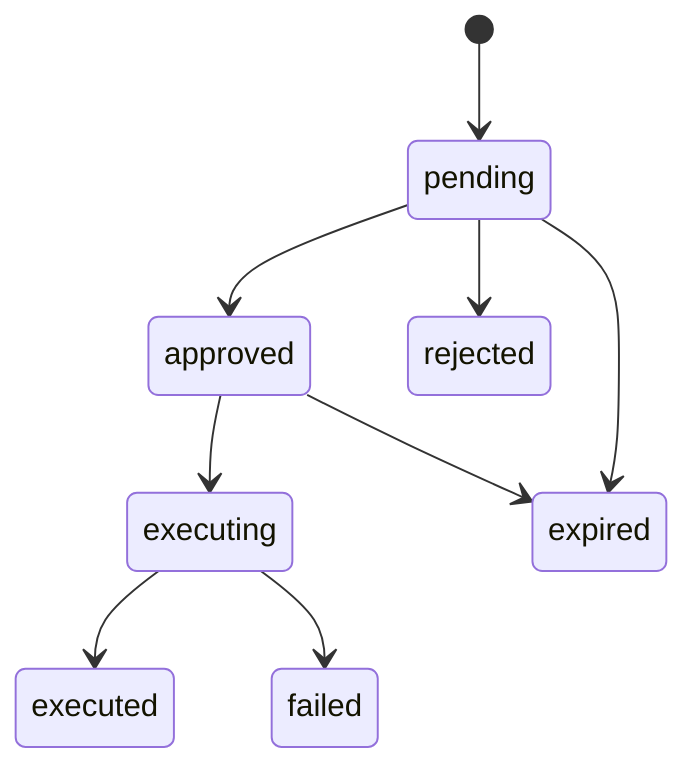

# API

Base URL: `http://127.0.0.1:3000`. Requests and responses use JSON. All responses carry a server-generated `X-Request-ID`. Token responses use `Cache-Control: no-store`.

## Login

`POST /auth/login`

```json
{ "tenantId": "<tenant UUID>", "email": "admin@example.invalid", "password": "<password>" }
```

HTTP 200:

```json
{ "accessToken": "<JWT>", "refreshToken": "<opaque token>", "expiresIn": 900 }
```

The email is matched exactly within the selected tenant. Passwords are verified against stored Argon2 hashes. Missing users, unknown tenants, and incorrect passwords all return HTTP 401 with `{"error":"Invalid credentials"}`. Malformed bodies and unexpected fields return 400. Five attempts per minute are allowed per connection IP; further attempts return 429. Forwarded-IP headers do not bypass this limit.

Access JWTs include `tenantId`, `userId`, `roles`, `iss`, `aud`, `iat`, `exp`, and `jti`. The signature algorithm is HS256 and the lifetime is 15 minutes. Role claims are snapshots; authorization uses current database memberships and permissions, not those snapshots. Do not send identity/role fields beyond the documented login fields.

## Refresh

`POST /auth/refresh`

```json
{ "tenantId": "<tenant UUID>", "refreshToken": "<most recently issued refresh token>" }
```

HTTP 200 returns the same token-response shape as login, with a new refresh token. Replace the old token immediately and serialize refresh calls. Tokens in a family expire seven days after its initial login; rotation does not extend that deadline. Unknown, expired, revoked, or reused tokens return 401 with `{"error":"Invalid token"}`. Reuse of any consumed token revokes the entire family, including newer descendants. Concurrent use of the same token is also reuse and invalidates the family. Other login sessions remain independent.

## Logout

`POST /auth/logout` accepts the same body as refresh. It revokes the token's family and returns 204 with no body. A consumed ancestor can also revoke its family. Repeating logout, or presenting an unknown well-formed token, still returns 204. Invalid bodies return 400.

Logout and refresh-family revocation do not invalidate existing access JWTs; they retain their original expiry. Revoked database permissions take effect on the next authenticated request because context is reloaded.

## Audit logs

`GET /audit-logs?limit=50&offset=0`

```sh
curl http://127.0.0.1:3000/audit-logs \
  -H "Authorization: Bearer <access JWT>"
```

Requires `audit_logs:read` and whole-tenant row scope (admin for the defined roles). Missing/invalid/expired Bearer tokens return 401; insufficient authorization returns 403. The response is an array of the current tenant's audit records, ordered by newest `createdAt`, then `id`. `limit` is 1–100; `offset` is 0–100000. Defaults are 50 and 0. Unknown query fields, including tenant selectors, return 400.

Each record contains `id`, `tenantId`, `actorUserId`, `action`, `entityType`, `entityId`, `requestId`, `details` (event metadata), `createdAt`, and `updatedAt`. Historical/system records may have null actor/entity/request IDs. Authentication events are `auth.login`, `auth.refresh`, `auth.refresh_reuse`, and `auth.logout`. No raw credentials or tokens are included in those events.

## Task proposal service

The agent/tool calls `createApprovalsService(database, mock).createProposal(request.context, input)` from authenticated server code. There is no separate proposal-creation HTTP endpoint. The strict input is:

```json
{
  "type": "task.create",
  "payload": {
    "title": "Call customer",
    "description": "Discuss renewal",
    "assigneeEmployeeId": "<employee UUID>",
    "dueAt": "2027-01-10T10:00:00Z"
  }
}
```

Tenant, requester, role, permissions, and request ID come from server context, never proposal input. The service trims text, normalizes timezone-qualified deadlines to UTC, validates the assignee's scope, stores a pending action with a 24-hour expiry, and writes `approval.created` atomically. It does not create a task. Reps can assign themselves, managers their department, and admins employees in their tenant. Identical inputs create independent proposal UUIDs.

## Approvals

All three routes require Bearer authentication.

| Method | Route | Behavior |
| --- | --- | --- |
| GET | `/approvals?status=pending&limit=50&offset=0` | List visible proposals with `approvals:read`. |
| POST | `/approvals/:id/approve` | Approve and synchronously execute if not already claimed/completed. |
| POST | `/approvals/:id/reject` | Reject a pending proposal. |

Decision requests have no body (or `{}`). A caller must have `approvals:decide` and be the requester, a manager in the requester's current department, or a tenant admin. Listing applies that ownership/department/admin scope. `status` accepts any of the seven action states; defaults are pending, limit 50, offset 0. Limit is 1–100; offset is 0–100000. Tenant filters and unknown fields are rejected. Pending/approved lists omit elapsed proposals; an authorized decision attempt persists their expired transition.

```sh
curl http://127.0.0.1:3000/approvals \
  -H "Authorization: Bearer <access JWT>"

curl -X POST http://127.0.0.1:3000/approvals/<proposal UUID>/approve \
  -H "Authorization: Bearer <access JWT>"
```

Decisions return the proposal record. Successful execution has `status: "executed"`, `executedAt`, and the attempt count; a completed unsuccessful execution returns HTTP 200 with `status: "failed"` and a safe `error`. Clients must inspect the action status. Concurrent/repeated approvals return the current state without restarting execution; a concurrent caller may observe `executing`. Rejection is idempotent. Approval also requires `tasks:create` and assignment scope for both requester and approver; a manager cannot approve an admin's proposal targeting another department. Unauthorized decisions return 403, other-tenant/missing proposals 404, invalid state changes 409, and expired decisions 410. Failed/rejected/expired proposals are terminal; requesting the same task again requires a new proposal UUID.



Approval and the conditional execution claim commit together with both audits. Each attempt is recorded. Only typed 5xx/timeout errors retry, with three total attempts and 250/500 ms backoff. Other 4xx, authorization/validation failures, and unexpected errors stop immediately. Permissions and assignment scope are rechecked before task insertion. Each state transition has an audit event with `details.from`/`details.to` (creation has only `to`); attempts and failures have separate events.

## Mock Bitrix methods

These authenticated POST methods run in the same app and database; no separate container or credentials are required. This is a minimal compatibility subset with UUID identifiers, not the full Bitrix API. Task input field naming follows [Bitrix24 tasks.task.add](https://apidocs.bitrix24.com/api-reference/tasks/tasks-task-add.html).

| Route | Body | Permission/scope |
| --- | --- | --- |
| `/rest/crm.deal.list` | `{ "limit": 50, "start": 0 }` or `{}` | `deals:read`; tenant/department/assigned deals. |
| `/rest/crm.contact.list` | Same pagination | `contacts:read`; admin tenant contacts, otherwise contacts linked to visible deals. |
| `/rest/tasks.task.get` | `{ "taskId": "<task UUID>" }` | `tasks:read`; tenant/department/assignee scope. |
| `/rest/tasks.task.add` | Task fields below | Eligible approver, an executing/executed proposal, and current requester assignment permissions. |

List limits are 1–100 and starts 0–100000, with defaults 50 and 0; unknown fields are rejected. List responses use `{ "result": [...] }`. Task get/add responses use `{ "result": { "task": { "id", "title", "description", "responsibleId", "deadline", "status" } } }`.

Task add requires `Idempotency-Key: <proposal UUID>` and this body:

```json
{
  "fields": {
    "TITLE": "Call customer",
    "DESCRIPTION": "Discuss renewal",
    "RESPONSIBLE_ID": "<employee UUID>",
    "DEADLINE": "2027-01-10T10:00:00Z"
  }
}
```

The fields must match the normalized proposal. Pending, rejected, expired, or failed proposals cannot create tasks through this route. A task's UUID is its proposal UUID; repeats return the existing matching task without another insert/audit. The executor uses the same operation in process, so no loopback HTTP client is needed. Old tasks with a null title display their description as a title fallback.

A process crash or final audit failure can leave an action executing; there is no background takeover or automatic recovery. See [security.md](security.md).

## Initial permissions and scopes

Provision permissions in each tenant's `permissions`, `roles`, `role_permissions`, and `user_roles` tables. There is no implicit admin permission bypass. The approval data migration augments existing admin/manager/rep roles with the five new workflow/read codes. Migration 0008 separately adds `companies:read` to existing admin/manager/rep roles. Tenants/roles created afterward need explicit provisioning. The matrix is:

| Permission | admin | sales_manager | sales_rep | viewer |
| --- | --- | --- | --- | --- |
| `deals:read` | Tenant | Department | Assigned records | Denied |
| `deals:aggregate` | Tenant | Department | Assigned records | Tenant aggregates |
| `departments:read` | Tenant | Own department | Denied | Denied |
| `audit_logs:read` | Tenant | Denied | Denied | Denied |
| `tasks:create` | Tenant assignees | Department assignees | Self | Denied |
| `tasks:read` | Tenant | Department | Assigned tasks | Denied |
| `contacts:read` | Tenant | Contacts of visible deals | Contacts of visible deals | Denied |
| `companies:read` | Tenant | Companies of visible deals | Companies of visible deals | Denied |
| `approvals:read` | Tenant | Own/department requesters | Own | Denied |
| `approvals:decide` | Tenant | Own/department requesters | Own | Denied |

The shared preHandler constructs `RequestContext { tenantId, userId, employeeId, departmentId, roles, permissions, requestId }`. Employee/department IDs may be null. Missing required scope links and unknown roles deny access; multiple roles use the broadest applicable scope. Viewer-only users cannot read individual records even if accidentally granted `deals:read`.

The mock routes demonstrate scoped CRM reads. Future routes/tools must call `can` and apply `scopeFilter` to queries. Only aggregate-producing queries may request aggregate scope; passing that mode does not itself convert a row query into an aggregate. The caller supplies the appropriate assignment column, for example `deals.responsibleEmployeeId` or `tasks.assigneeEmployeeId`. Without an assignment column, employee/department row scopes fail closed.

## Internal SQL analytics API

The SQL Analytics Tool calls `runAnalyticsQuery(request.context, sql, question?)` from `src/sql-guard/execute.ts`. This change adds no HTTP SQL endpoint. The optional question is stored in `sql_execution_log`, or NULL when omitted. Results are arrays of at most 200 row objects; PostgreSQL money/numeric/bigint values may be strings.

```ts
const rows = await runAnalyticsQuery(ctx,
  "SELECT currency, status, count(*) AS total, sum(amount) AS amount FROM v_deals GROUP BY currency, status",
  'Համեմատիր գործարքների կարգավիճակները / Compare deal statuses');
```

Sources are `v_deals`, `v_tasks`, `v_contacts_activity`, and `v_employee_performance`; their fields are documented in [database.md](database.md#analytics-views). Examples include unfinished tasks where `due_at < now()`, contacts where `last_activity_at IS NULL OR last_activity_at < now() - interval '14 days'`, and department/currency won revenue from `v_employee_performance`. Tenant/department/own-record scope comes from refreshed server identity, never SQL parameters supplied as identity.

All calls require `deals:aggregate`. Detail reads also require the view's resource read permission. Viewers can run the conservative aggregate-only subset, including currency/status/department/date groups, but cannot retrieve individual IDs/names or employee-level performance rows. See [security.md](security.md#guarded-sql-analytics) for the exact allowlist and role behavior.

The runner logs rejected SQL/authorization attempts and query errors before throwing. Errors are 400 for unsupported/unsafe input or viewer detail requests, 403 for missing permissions, 422 for execution/schema errors, and 504 for the five-second timeout. Logging failures propagate rather than returning an unaudited result. Queries use bound literals and a regenerated, capped AST; no user SQL reaches execution unchanged.

## Minimal local admin account

For ready-made development accounts, run `npm run db:seed` after migrations and database password setup; see [seed-scenarios.md](seed-scenarios.md) for tenant UUIDs and credentials. The following is an optional manual provisioning alternative. First run migrations and provision the PostgreSQL `app_user` password as described in [security.md](security.md). Generate an Argon2 hash interactively (the password is read from terminal input, not passed in shell arguments):

```sh
node --input-type=module -e '
import { hash } from "argon2";
import { createInterface } from "node:readline/promises";
const terminal = createInterface({ input: process.stdin, output: process.stdout });
const password = await terminal.question("CRM password: ");
terminal.close();
console.log(await hash(password));
'
```

Then open the administrative database console:

```sh
docker compose exec db psql -U migration_owner -d ops_copilot
```

Run this command **alone**, then paste the complete generated hash at its prompt:

```text
\prompt 'Argon2 hash: ' password_hash
```

Run each following block separately, pressing Enter after each `\gset` before pasting the next block. Do not bulk-paste the prompt together with SQL. Run once to create a demo tenant and admin; if an insert fails, use `ROLLBACK;` before starting again.

```sql
BEGIN;
INSERT INTO tenants (name) VALUES ('Demo tenant') RETURNING id AS tenant_id
\gset
```

```sql
INSERT INTO users (tenant_id, email, name, password_hash)
VALUES (:'tenant_id', 'admin@example.invalid', 'Demo admin', :'password_hash')
RETURNING id AS user_id
\gset
```

```sql
INSERT INTO roles (tenant_id, name) VALUES (:'tenant_id', 'admin')
RETURNING id AS role_id
\gset
```

```sql
INSERT INTO permissions (tenant_id, code, description)
SELECT :'tenant_id'::uuid, code, code FROM unnest(ARRAY[
  'deals:read', 'deals:aggregate', 'departments:read', 'audit_logs:read',
  'contacts:read', 'companies:read', 'tasks:read', 'tasks:create', 'approvals:read', 'approvals:decide'
]) AS codes(code);
INSERT INTO role_permissions (tenant_id, role_id, permission_id)
SELECT tenant_id, :'role_id'::uuid, id FROM permissions WHERE tenant_id = :'tenant_id';
INSERT INTO user_roles (tenant_id, user_id, role_id)
VALUES (:'tenant_id', :'user_id', :'role_id');
INSERT INTO employees (tenant_id, user_id, name)
VALUES (:'tenant_id', :'user_id', 'Demo admin') RETURNING id AS assignee_employee_id;
COMMIT;
```

Run the final command separately to print your tenant ID:

```text
\echo Login tenantId: :tenant_id
```

Start `npm run dev`, then log in with the printed tenant UUID, `admin@example.invalid`, and the original password. Save the returned employee UUID for task-proposal input. The PostgreSQL account password and this CRM user's password are separate credentials.

## Chat

`POST /chat` requires Bearer authentication. The strict request body is:

```json
{ "message": "Show lost deals from the last 30 days", "allowTaskDraft": false }
```

`message` is nonempty text up to 8,000 characters; `allowTaskDraft` defaults to false. Tenant/user/role/context fields and arbitrary message histories are rejected. The server reloads identity, permissions, and scope from the authenticated request. Clients cannot provide system prompts or tool results.

```json
{
  "answer": "There are 600 deals.",
  "toolCalls": [{
    "toolCallId": "<model-call-id>",
    "name": "sql_analytics",
    "status": "succeeded",
    "sql": "SELECT count(*) AS total FROM v_deals",
    "rowCount": 1
  }],
  "pendingActionIds": []
}
```

This response is illustrative; live wording and SQL depend on the model. Tool summaries report succeeded/failed without raw arguments, database diagnostics, or SDK errors. SQL summaries include the accepted SQL and row count. No model-generated ID is reported as an actual pending action: IDs come from successful proposal inserts.

| Tool | Behavior |
| --- | --- |
| `crm_search` | Contacts/companies/deals using strict filters and fresh RBAC. Common filters: `id`, `query` (literal name/title substring), `createdAfter`, `limit` (1–50). Contacts/deals additionally accept `companyId`; deals also accept `contactId`, `status`, `closedAfter`. Dates are timezone-qualified ISO timestamps. Contacts include up to three scoped recent activity notes from a bounded activity read. No email/phone fields are sent to the model. |
| `sql_analytics` | Accepts `question`, generates SQL from only the allowed view columns, and runs the existing guarded runner. A 400/403 rejection receives one safe correction; a second rejection disables SQL attempts for that request. Execution errors/timeouts refuse immediately. Failed SQL results cannot be rewritten into an apparent successful answer by the outer agent. |
| `task_draft` | Available only with explicit `allowTaskDraft:true`. Validates the existing title/description/assigneeEmployeeId/dueAt payload and creates a pending proposal plus audit. It has no approval/execution method. |
| `kb_search` | Accepts `question`, calls `answerFromKb` with the application database, and returns a cited answer or refusal using the configured embedding model/threshold. If the outer response drops or invents citations, chat returns the validated KB answer instead. |
| `audit_activity` | Accepts `limit` (1–30) and reads recent tenant audit entries with `audit_logs:read` and whole-tenant scope. |

For drafting:

```json
{
  "message": "Draft a task for me: call the customer, confirm order details, deadline 2027-01-10T10:00:00Z.",
  "allowTaskDraft": true
}
```

If an employee ID or required detail cannot be resolved, the agent should ask rather than invent it. The authenticated employee ID is supplied by server context for self-assignment. A successful draft stops the loop and returns a deterministic preview containing pending action ID, title, description, assignee name/ID, and normalized UTC deadline. The answer states that approval is required. Read it, then call the existing approve/reject endpoints. `allowTaskDraft:true` never grants execution permission or counts as approval. Repeated independent chat requests may create independent proposals, consistent with proposal-UUID idempotency.

Model creation is lazy; missing provider credentials do not break health/auth startup. Invalid bodies return 400, unauthenticated requests 401, provider/configuration failures 503 with a safe message, and tool-level denials are reported in the chat result. If the outer model loop reaches its 300-second (five-minute) deadline, `/chat` returns HTTP 504 with `{"error":"AI request timed out after 300 seconds. Try a simpler request."}`. A provider `TimeoutError` before that deadline returns HTTP 504 with `{"error":"AI provider timed out. Try again or simplify your request."}`. Neither response exposes provider diagnostics. If a proposal was already saved, its pending-approval preview and IDs still take precedence over a model failure; the action is never executed automatically. Model requests receive two SDK retries with exponential backoff for retryable errors including 429; the entire workflow is never retried. The outer loop uses AI SDK 7 `isStepCount(6)` and stops early on task drafts. Inner SQL/KB calls are separate from this step count. Each model-visible tool result is bounded to 8,000 UTF-8 bytes and marked untrusted/truncated where necessary. This is an approximate token cap; Armenian token density differs.

Test coverage uses mocked language models with real disposable PostgreSQL. Live model tool selection, Armenian wording, and prompt-injection robustness still require evaluation; no live-model accuracy claim follows from mocked tests.

The 300-second agent deadline starts after authentication, before the agent refreshes context, and covers model calls and tool waits. The handler races the workflow against expiry in addition to signalling cancellation, so an uncooperative provider or tool cannot keep it awaiting that promise indefinitely. Nested SQL generation and KB answer generation inherit the same deadline rather than starting another five-minute window. Cancellation checks prevent new tools, late SQL results, and task proposals from starting work after expiry. Cancellation does not forcibly undo an already-running database transaction: an in-flight proposal can still finish as pending and is discoverable through `GET /approvals`. The agent never approves or executes it. Authentication and infrastructure delays before the agent handler are outside this deadline.

## Local model configuration

Chat, SQL generation, and KB answer generation default to `LLM_PROVIDER=ollama`, `LLM_MODEL=gemma4:26b`, and `OLLAMA_BASE_URL=http://127.0.0.1:11434/v1`. Ollama must be running with the model installed (`ollama pull gemma4:26b` on a fresh machine). The shared factory uses the Vercel AI SDK OpenAI-compatible adapter and local `/v1/chat/completions`, including tool calls, without a cloud API key. The HTTP `/chat` request/response contract and authorization checks are unchanged. Google and Gateway remain explicit env-selectable options. Google embedding calls are configured separately and are still required for KB ingestion/search.
