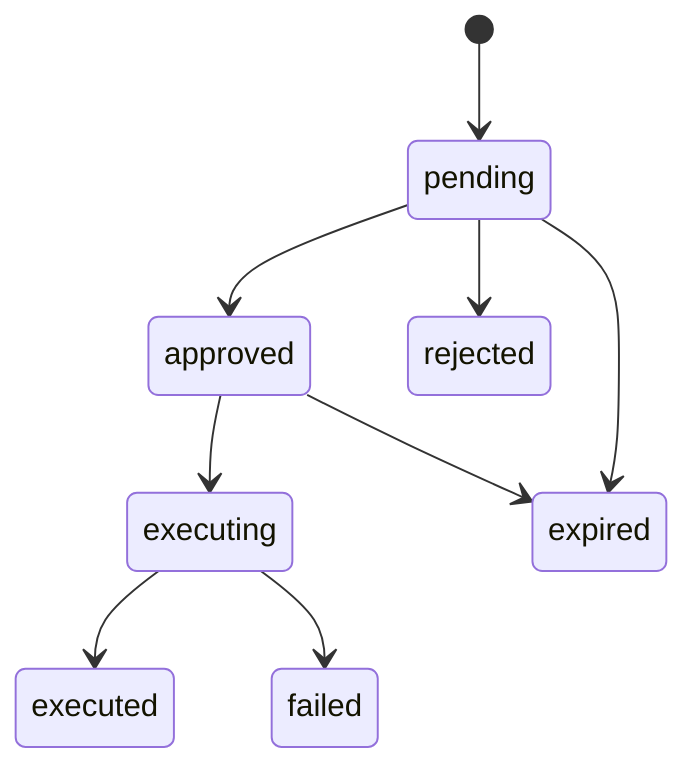

# API

Base URL: `http://127.0.0.1:3000`. JSON everywhere. Every response carries a server-generated `X-Request-ID`; token responses add `Cache-Control: no-store`.

## Login

`POST /auth/login`

```json
{ "tenantId": "<tenant UUID>", "email": "admin@example.invalid", "password": "<password>" }
```

```json
{ "accessToken": "<JWT>", "refreshToken": "<opaque token>", "expiresIn": 900 }
```

Email is matched exactly within the selected tenant; passwords verify against Argon2 hashes. Unknown tenant/user or wrong password → 401 `{"error":"Invalid credentials"}`. Malformed/extra fields → 400. 5 attempts/min per connection IP (forwarded-IP headers don't bypass it).

Access JWTs carry `tenantId`, `userId`, `roles`, `iss`, `aud`, `iat`, `exp`, `jti` — HS256, 15-minute lifetime. Roles are a snapshot; authorization always re-checks current DB memberships. Don't send identity/role fields beyond the documented login body.

## Refresh

`POST /auth/refresh`

```json
{ "tenantId": "<tenant UUID>", "refreshToken": "<most recently issued refresh token>" }
```

Returns the same shape as login, with a new refresh token — replace the old one immediately and serialize calls. A family expires 7 days after its initial login regardless of rotation. Unknown/expired/revoked/reused tokens → 401 `{"error":"Invalid token"}`. Reusing *any* consumed token (including concurrent use of the same one) revokes the whole family; other login sessions are unaffected.

## Logout

`POST /auth/logout` takes the same body as refresh, revokes the token's family, returns 204 (idempotent — repeats and unknown-but-well-formed tokens still 204; invalid bodies 400). Doesn't invalidate already-issued access JWTs (they just expire normally); revoked permissions apply on the next authenticated request since context reloads every time.

## Audit logs

`GET /audit-logs?limit=50&offset=0` — needs `audit_logs:read` + whole-tenant scope (admin-only among current roles). 401 on bad auth, 403 on insufficient permission, 400 on unknown query fields (including a tenant selector). Returns the tenant's records newest-first (`createdAt`, then `id`); `limit` 1–100, `offset` 0–100000, defaults 50/0.

```sh
curl http://127.0.0.1:3000/audit-logs -H "Authorization: Bearer <access JWT>"
```

Each record: `id`, `tenantId`, `actorUserId`, `action`, `entityType`, `entityId`, `requestId`, `details`, `createdAt`, `updatedAt` (actor/entity/request may be null for historical/system rows). Auth events are `auth.login`/`auth.refresh`/`auth.refresh_reuse`/`auth.logout`, never containing raw credentials.

## Metrics

`GET /metrics` — Prometheus text, unauthenticated like `/health`: `http_server_request_count`/`http_server_request_duration_ms` (by route/method/status), `tool_error_count` (by tool), `llm_tokens_total` (by model/token type). See [README.md](../README.md#observability) for the OTLP trace spans.

## Task proposal service

No HTTP endpoint — the agent/tool calls `createApprovalsService(database, mock).createProposal(request.context, input)` server-side:

```json
{
  "type": "task.create",
  "payload": { "title": "Call customer", "description": "Discuss renewal", "assigneeEmployeeId": "<employee UUID>", "dueAt": "2027-01-10T10:00:00Z" }
}
```

Tenant/requester/role/permissions/request ID always come from server context, never the input. The service trims text, normalizes deadlines to UTC, validates assignee scope, and writes a pending action (24h expiry) plus `approval.created` atomically — it does not create a task. Reps assign themselves, managers their department, admins anyone in-tenant. Identical inputs still produce independent proposal UUIDs.

## Approvals

All three need Bearer auth.

| Method | Route | Behavior |
| --- | --- | --- |
| GET | `/approvals?status=pending&limit=50&offset=0` | List visible proposals (`approvals:read`). |
| POST | `/approvals/:id/approve` | Approve; executes synchronously unless already claimed/completed. |
| POST | `/approvals/:id/reject` | Reject a pending proposal. |

Decisions take no body. Caller needs `approvals:decide` and to be the requester, the requester's department manager, or a tenant admin — listing uses the same scope. `status` accepts any of the seven states (default pending); limit 1–100/offset 0–100000 (default 50/0); unknown fields or a tenant filter are rejected. Elapsed proposals drop out of pending/approved lists; the next authorized decision attempt persists their expiry.

```sh
curl http://127.0.0.1:3000/approvals -H "Authorization: Bearer <access JWT>"
curl -X POST http://127.0.0.1:3000/approvals/<proposal UUID>/approve -H "Authorization: Bearer <access JWT>"
```

A decision returns the proposal record: `executed` with `executedAt`/attempt count on success, or 200 with `status: "failed"` + a safe `error` — clients must check status, not just HTTP code. Concurrent/repeat approvals return current state without re-running (`executing` may be observed mid-flight); rejection is idempotent. Approval also needs `tasks:create` + assignment scope for *both* requester and approver (a manager can't approve an admin's cross-department proposal). 403 unauthorized, 404 cross-tenant/missing, 409 invalid transition, 410 expired. Failed/rejected/expired are terminal — a repeat needs a new proposal.



Approval and the execution claim commit together with both audits; only typed 5xx/timeouts retry (3 attempts, 250/500ms backoff) — everything else stops immediately. Permissions/scope are re-checked right before task insertion. Every transition gets its own audit event (`details.from`/`to`; creation has only `to`).

## Mock Bitrix methods

Authenticated POSTs in the same app/database — no separate container. Minimal UUID-keyed subset, not the full Bitrix API; task fields follow [Bitrix24's `tasks.task.add`](https://apidocs.bitrix24.com/api-reference/tasks/tasks-task-add.html).

| Route | Body | Permission/scope |
| --- | --- | --- |
| `/rest/crm.deal.list` | `{ "limit": 50, "start": 0 }` or `{}` | `deals:read`; tenant/department/assigned. |
| `/rest/crm.contact.list` | same pagination | `contacts:read`; admin = tenant, else linked to visible deals. |
| `/rest/tasks.task.get` | `{ "taskId": "<uuid>" }` | `tasks:read`; tenant/department/assignee. |
| `/rest/tasks.task.add` | fields below | eligible approver + executing/executed proposal + current assignment permissions. |

Limits 1–100/starts 0–100000 (default 50/0), unknown fields rejected. Lists return `{ "result": [...] }`; get/add return `{ "result": { "task": { "id", "title", "description", "responsibleId", "deadline", "status" } } }`.

`tasks.task.add` requires header `Idempotency-Key: <proposal UUID>` and:

```json
{ "fields": { "TITLE": "Call customer", "DESCRIPTION": "Discuss renewal", "RESPONSIBLE_ID": "<employee UUID>", "DEADLINE": "2027-01-10T10:00:00Z" } }
```

Fields must match the normalized proposal; pending/rejected/expired/failed proposals can't create tasks this way. The task UUID equals the proposal UUID, so repeats return the existing task (no duplicate insert/audit) — the executor reuses this same in-process operation, no loopback HTTP. Legacy null-title tasks fall back to displaying their description.

A crash or failed final audit can leave an action stuck `executing` — no background takeover/recovery (see [security.md](security.md)).

## Initial permissions and scopes

Permissions live per-tenant in `permissions`/`roles`/`role_permissions`/`user_roles` — no implicit admin bypass. The approval migration added five workflow/read codes to existing admin/manager/rep roles; migration 0008 separately added `companies:read` the same way. Tenants/roles created later need explicit provisioning.

| Permission | admin | sales_manager | sales_rep | viewer |
| --- | --- | --- | --- | --- |
| `deals:read` | Tenant | Department | Assigned | Denied |
| `deals:aggregate` | Tenant | Department | Assigned | Tenant aggregates |
| `departments:read` | Tenant | Own department | Denied | Denied |
| `audit_logs:read` | Tenant | Denied | Denied | Denied |
| `tasks:create` | Tenant assignees | Department assignees | Self | Denied |
| `tasks:read` | Tenant | Department | Assigned | Denied |
| `contacts:read` | Tenant | Visible-deal contacts | Visible-deal contacts | Denied |
| `companies:read` | Tenant | Visible-deal companies | Visible-deal companies | Denied |
| `approvals:read` | Tenant | Own/department | Own | Denied |
| `approvals:decide` | Tenant | Own/department | Own | Denied |

The shared preHandler builds `RequestContext { tenantId, userId, employeeId, departmentId, roles, permissions, requestId }` (employee/department nullable). Missing scope links or unknown roles deny access; multiple roles get the broadest scope; viewers can't read individual records even if `deals:read` is mistakenly granted.

Every query must call `can` and apply `scopeFilter` with the right assignment column (e.g. `deals.responsibleEmployeeId`, `tasks.assigneeEmployeeId`) — without one, employee/department scope fails closed. Only queries proven aggregate may request aggregate scope; requesting it doesn't itself convert a row query.

## Internal SQL analytics API

No HTTP endpoint — `runAnalyticsQuery(request.context, sql, question?)` (`src/sql-guard/execute.ts`). The optional `question` is logged (or NULL); results are ≤200 row objects, with Postgres money/numeric/bigint possibly returned as strings.

```ts
const rows = await runAnalyticsQuery(ctx,
  "SELECT currency, status, count(*) AS total, sum(amount) AS amount FROM v_deals GROUP BY currency, status",
  'Համեմատիր գործարքների կարգավիճակները / Compare deal statuses');
```

Sources: `v_deals`, `v_tasks`, `v_contacts_activity`, `v_employee_performance` (fields in [database.md](database.md#analytics-views)) — e.g. overdue tasks via `due_at < now()`, stale contacts via `last_activity_at < now() - interval '14 days'`. Scope always comes from refreshed server identity, never SQL-supplied values.

All calls need `deals:aggregate`; detail reads also need the view's own read permission. Viewers get the conservative aggregate-only subset (currency/status/department/date grouping, no IDs/names, no employee-performance rows) — see [security.md](security.md#guarded-sql-analytics) for the full allow-list. Rejections/errors are logged before throwing: 400 unsupported/unsafe input or viewer detail request, 403 missing permission, 422 execution/schema error, 504 timeout (5s). Only bound literals and a regenerated, capped AST ever execute — never the submitted text verbatim.

## Minimal local admin account

`npm run db:seed` gives ready-made accounts (see [seed-scenarios.md](seed-scenarios.md)) — this is only a manual fallback. After migrating and setting the `app_user` password ([security.md](security.md)), generate an Argon2 hash interactively (password read from stdin, never a shell argument):

```sh
node --input-type=module -e '
import { hash } from "argon2";
import { createInterface } from "node:readline/promises";
const terminal = createInterface({ input: process.stdin, output: process.stdout });
const password = await terminal.question("CRM password: ");
terminal.close();
console.log(await hash(password));
'
```

Open an admin console, capture the hash into a psql variable, then run the block once (if an insert fails, `ROLLBACK;` and retry):

```sh
docker compose exec postgres psql -U migration_owner -d ops_copilot
```

```text
\prompt 'Argon2 hash: ' password_hash
```

```sql
BEGIN;
INSERT INTO tenants (name) VALUES ('Demo tenant') RETURNING id AS tenant_id
\gset
```

```sql
INSERT INTO users (tenant_id, email, name, password_hash)
VALUES (:'tenant_id', 'admin@example.invalid', 'Demo admin', :'password_hash')
RETURNING id AS user_id
\gset
```

```sql
INSERT INTO roles (tenant_id, name) VALUES (:'tenant_id', 'admin')
RETURNING id AS role_id
\gset
```

```sql
INSERT INTO permissions (tenant_id, code, description)
SELECT :'tenant_id'::uuid, code, code FROM unnest(ARRAY[
  'deals:read', 'deals:aggregate', 'departments:read', 'audit_logs:read',
  'contacts:read', 'companies:read', 'tasks:read', 'tasks:create', 'approvals:read', 'approvals:decide'
]) AS codes(code);
INSERT INTO role_permissions (tenant_id, role_id, permission_id)
SELECT tenant_id, :'role_id'::uuid, id FROM permissions WHERE tenant_id = :'tenant_id';
INSERT INTO user_roles (tenant_id, user_id, role_id)
VALUES (:'tenant_id', :'user_id', :'role_id');
INSERT INTO employees (tenant_id, user_id, name)
VALUES (:'tenant_id', :'user_id', 'Demo admin') RETURNING id AS assignee_employee_id;
COMMIT;
```

```text
\echo Login tenantId: :tenant_id
```

Press Enter after each `\gset` before pasting the next block — don't bulk-paste. Then `npm run dev` and log in with the printed tenant UUID, `admin@example.invalid`, and your chosen password (the Postgres account password is a separate credential). Save the returned employee UUID for task proposals.

## Chat

`POST /chat`, Bearer auth required:

```json
{ "message": "Show lost deals from the last 30 days", "allowTaskDraft": false }
```

`message`: 1–8000 chars; `allowTaskDraft` defaults false. Tenant/user/role/context fields and message history are rejected — identity/permissions/scope always reload from the authenticated request.

```json
{
  "answer": "There are 600 deals.",
  "toolCalls": [{ "toolCallId": "<id>", "name": "sql_analytics", "status": "succeeded", "sql": "SELECT count(*) AS total FROM v_deals", "rowCount": 1 }],
  "pendingActionIds": []
}
```

(Illustrative — real wording/SQL depends on the model.) Tool summaries show succeeded/failed only, never raw arguments or DB diagnostics; a reported pending-action ID always comes from an actual successful insert, never model text.

| Tool | Behavior |
| --- | --- |
| `crm_search` | Contacts/companies/deals, strict filters + fresh RBAC. Filters: `id`, `query` (substring), `createdAfter`, `limit` (1–200); deals/contacts add `companyId`; deals add `contactId`, `status`, `closedAfter`. Up to 3 scoped activity notes per contact; never email/phone. |
| `sql_analytics` | Takes `question`, generates SQL from allowed view columns only, runs the guarded runner. One safe correction after a 400/403; a second rejection disables SQL for that request. |
| `task_draft` | Only present with `allowTaskDraft:true`. Validates title/description/assigneeEmployeeId/dueAt, creates a pending proposal + audit. No approve/execute capability. |
| `kb_search` | Takes `question`, calls `answerFromKb`, returns a cited answer or refusal per the configured threshold. Chat falls back to the validated answer if the outer model drops/invents citations. |
| `audit_activity` | `limit` (1–30), recent tenant audit entries; needs `audit_logs:read` + whole-tenant scope. |

Drafting example:

```json
{ "message": "Draft a task for me: call the customer, confirm order details, deadline 2027-01-10T10:00:00Z.", "allowTaskDraft": true }
```

The agent should ask rather than invent an unresolved detail; the authenticated employee ID covers self-assignment. A successful draft ends the loop with a deterministic preview (pending action ID, title, description, assignee, normalized UTC deadline) stating approval is required — call the existing approve/reject routes next. `allowTaskDraft:true` never itself grants execution or counts as approval; repeated chat requests can create independent proposals.

Model creation is lazy (no provider credentials needed for health/auth to work). 400 invalid body, 401 unauthenticated, 503 provider/config failure (safe message), tool denials surface in the result. Hitting the 300-second deadline → 504 `"AI request timed out after 300 seconds..."`; a provider timeout before that → a distinct 504 message — neither leaks provider diagnostics. An already-saved draft's preview still takes precedence over a later model failure; nothing executes automatically. Model calls get 2 SDK retries with backoff (including on 429); the whole workflow is never retried. The outer loop uses AI SDK 7 `isStepCount(6)`, stopping early on a draft; inner SQL/KB calls don't count against it. Each tool result is capped at 8,000 UTF-8 bytes (~2,000 English tokens — Armenian density differs) and marked untrusted/truncated as needed.

Tests use mocked models against real disposable Postgres — live tool selection, Armenian wording, and injection robustness still need separate evaluation.

The 300-second deadline starts post-authentication, before context refresh, covering model calls and tool waits; the handler races the whole workflow against expiry (not just a cooperative abort signal), so an uncooperative provider/tool can't hang it indefinitely. Nested SQL/KB generation share this one deadline. Cancellation blocks new tools/late results/new proposals, but doesn't roll back an already-running DB transaction — an in-flight proposal can still land as pending, visible via `GET /approvals`, never auto-approved. Delays before the handler (auth, infra) are outside this deadline.

## Local model configuration

Defaults: `LLM_PROVIDER=ollama`, `LLM_MODEL=gemma4:26b`, `OLLAMA_BASE_URL=http://127.0.0.1:11434/v1` — Ollama must be running with the model pulled. The shared factory uses the AI SDK's OpenAI-compatible adapter against local `/v1/chat/completions`, tool calls included, no cloud key. The `/chat` contract and auth checks are unchanged regardless of provider. Google/Gateway remain explicit env-selectable alternatives; Google embeddings stay separately configured and are still required for KB ingestion/search.
