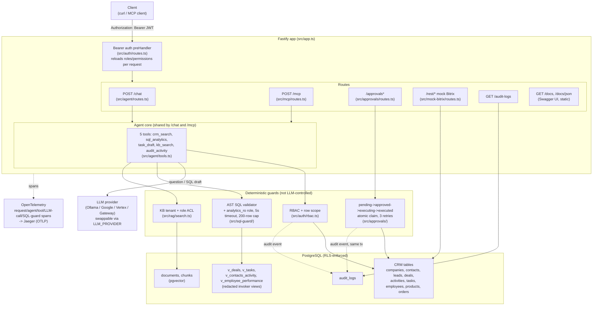
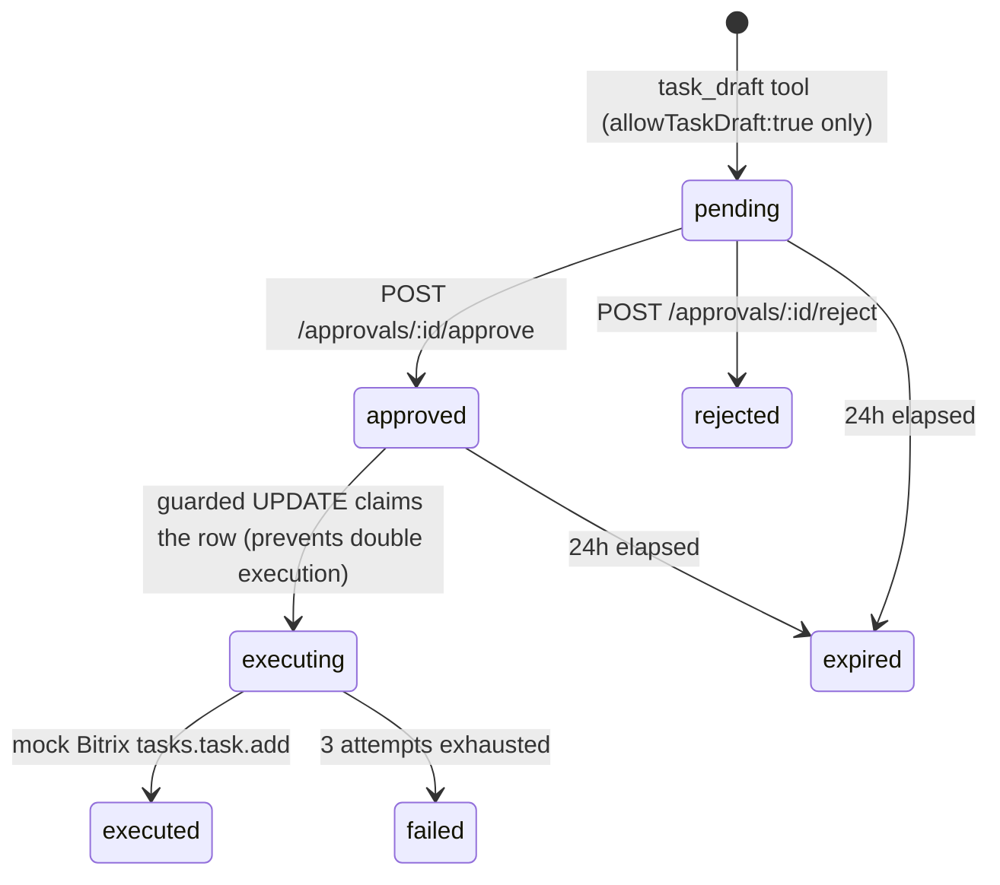
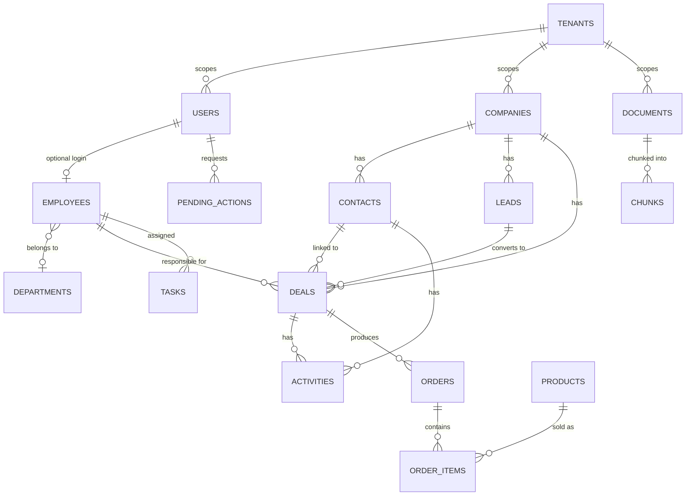

# Architecture

This is a modular monolith: one Fastify process, one PostgreSQL database, no separate services or queues. See [decisions.md](decisions.md) for why (explicitly scoped out in [MVP_SCOPE.md](../MVP_SCOPE.md)).

## System overview



## Request flow for a typical chat query

```mermaid
sequenceDiagram
    participant U as Client
    participant A as Fastify /chat
    participant G as Agent (generateText, stopWhen 6 steps)
    participant T as Tool (e.g. sql_analytics)
    participant V as SQL AST guard
    participant DB as PostgreSQL (analytics_ro, RLS)
    participant L as LLM provider

    U->>A: POST /chat {message, allowTaskDraft}
    A->>A: verify JWT, reload roles/permissions/scope
    A->>G: run agent with fresh RequestContext-bound tools
    G->>L: plan next step
    L-->>G: tool call: sql_analytics(question)
    G->>T: execute(question)
    T->>L: generate SQL from allowed view columns only
    L-->>T: candidate SQL
    T->>V: validate AST (read-only, allow-listed relations/functions)
    V->>DB: SET LOCAL ROLE analytics_ro; run with 5s timeout, LIMIT 200
    DB-->>V: rows
    V-->>T: rows + accepted SQL
    T-->>G: bounded result (<=8000 UTF-8 bytes, marked untrusted)
    G->>L: continue with tool result
    L-->>G: final answer
    G-->>A: answer, toolCalls summary, pendingActionIds
    A-->>U: 200 JSON
```

## Human-in-the-loop task approval



Every arrow above that changes state also writes an `audit_logs` row in the same transaction — see [decisions.md](decisions.md#approval-execution-and-idempotency).

## Entity relationships (core CRM tables)

Full column-level detail, constraints, and the knowledge-base/security/identity tables are in [database.md](database.md). This covers only the primary CRM relationships referenced above.



Every table here except `TENANTS` carries a `tenant_id` enforced by PostgreSQL row-level security (`drizzle/0001_tenant_rls.sql`), not just an application-level filter — see [decisions.md](decisions.md#tenant-row-level-security).

## Why this shape

- **One agent, five tools, no multi-agent orchestration** — [MVP_SCOPE.md](../MVP_SCOPE.md) explicitly scopes out multi-agent architecture for the core deliverable (see the assignment's bonus section for the optional Planner/Executor/Validator variant, not implemented here).
- **SQL guard and KB ACL sit outside the LLM's control** — the model drafts SQL/questions, but a deterministic AST validator and tenant/role-scoped SQL predicates decide what actually runs or returns, so a prompt-injected or hallucinated request cannot widen access on its own.
- **`/chat` and `/mcp` share one tool implementation** (`src/agent/tools.ts` factories), not two parallel code paths — see [mcp.md](mcp.md) and [decisions.md](decisions.md#mcp-server).
